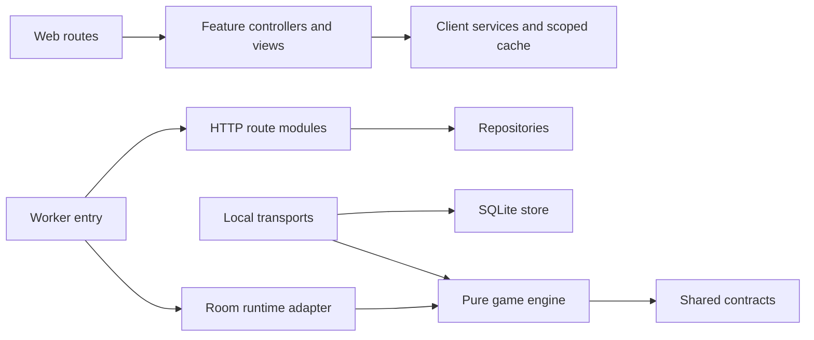

# Architecture and performance refactor

## Boundaries

- `apps/web/src/app`: route entry points and composition. Studio, question editing, creator login, presenter and player behavior live in their own feature folders.
- `apps/web/src/features/quiz-studio`: separate resource, ordering, media, title and launch controllers; independent header, details and question-list views. Live host/player snapshots use explicit contract-derived types.
- `apps/web/src/styles`: tokens, foundation, controls, avatars, gameplay motion, identity and studio styles, imported in the original cascade order.
- `apps/worker/src/index.ts`: platform entry point and asset dispatch. `app.ts` registers named route modules; repositories do not depend on HTTP transport.
- `apps/worker/src/durable-objects`: the Cloudflare lifecycle adapter delegates HTTP, socket messages, persistence effects, telemetry and broadcast through an explicit room runtime port.
- `apps/worker/src/repositories/quizzes`: records, reads, quiz commands, question validation/commands and publishing. Compatibility exports preserve existing imports.
- `packages/game-core/src/engine`: platform-independent lifecycle, answers/scoring, transitions and recovery.
- `apps/local/src`: runtime/session composition, HTTP and socket transports, and the SQLite store. Durable answer receipts still follow successful writes.

## Guardrails

`pnpm quality` checks formatting, dependency boundaries, runtime import cycles, TypeScript, all tests, production export and the projection benchmark. `pnpm architecture` enforces 300 lines per production source/style file and 400 per test file. Formatting is pinned with Prettier; generated compiler caches are ignored. `pnpm lan:build` verifies the separate LAN export. No database migrations, endpoint changes or persisted room format changes are introduced.

## Appropriate caching

A broadcast creates one ephemeral public projection shared by the host/player serializers. Ranks, redacted question data and public roster are calculated once, then discarded before the next state update. Live mutable game state and answer keys are not put into a long-lived cache.

The local SQLite store caches up to 32 prepared statements, while executing each read against current durable data. Existing account-scoped client caches, optimistic ordering, targeted invalidation, lazy images and the protections against stale HTML/RSC remain intact.

## Verified results

- Full check passes: 148 tests (contracts 6, core 10, worker 58, web 65, local 9), all workspace type checks, cloud export and LAN export.
- The checked-in historical serializer fixture comes from Git commit `c711fd2a3d07838b825e08389dd9ba933379d1ee` (no Git history is needed to run it) for a reproducible comparison of one host plus 150 player DTOs. Across 100 iterations, the recorded run reduced median projection CPU time by approximately 98%; exact median/p95 values are in the generated JSON report. Objects are asserted identical. This measures DTO preparation, excluding network/JSON transport.
- The latest 150-client real localhost WebSocket rehearsal returned durable receipts with p95 219 ms and no duplicate scores. The initial app rehearsal was 237 ms; scheduling/storage variation means this small difference is not an Internet/Wi-Fi speed guarantee.
- Browser checks with production assets covered studio ordering/title editing, cached question editing, presenter connection/start, a simulated failed end request followed by successful retry, player answer receipts/finale, and a 390 px player view without horizontal overflow.
- UX reliability: failed presenter end requests release busy state and show a retryable error; leaving the lobby navigates immediately while the bounded keepalive request completes. Studio title timers clean up when navigating away.

The shared first-load JS remains 102 kB. The studio's first-load total moved from 161 to 162 kB, an approximately 1 kB cost for the separated modules and typesafe composition; no general page-speed percentage is inferred from the CPU benchmark.

The latest machine-readable benchmark is in `performance/snapshot-projection.json`; rerun with `pnpm performance`.

The Google identity SDK now loads only on the creator login screen, rather than on every player/host/page; the existing login-specific Next Script lifecycle is preserved.
